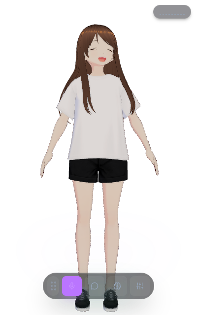
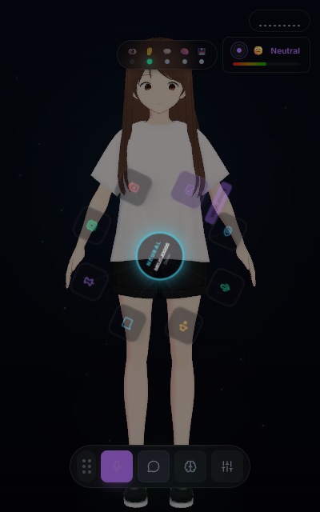
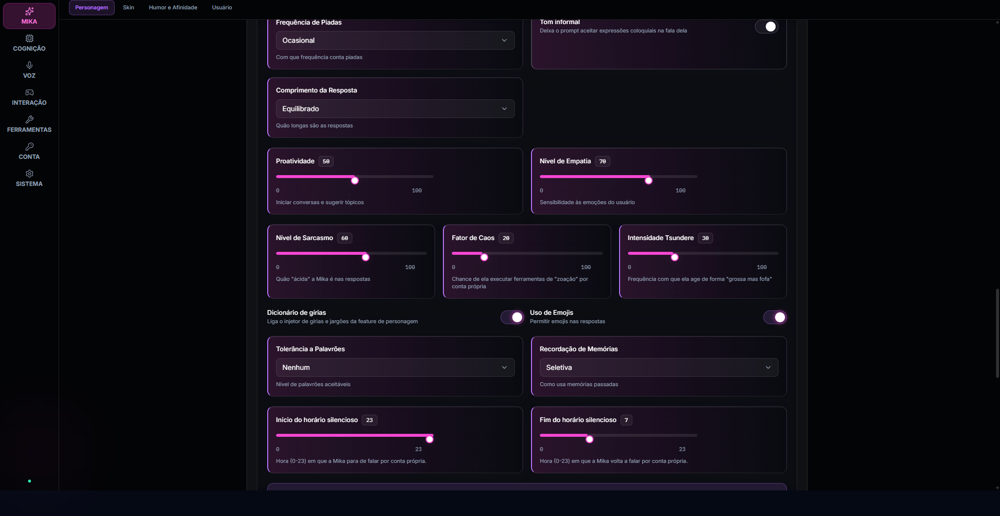
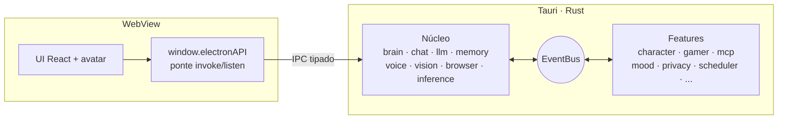

<div align="center">



# Mika

**Companheira de desktop para games, código e cultura nerd.**<br/>
Ela escuta, olha a tela, conversa por voz ou texto, usa ferramentas — e diz o que está fazendo enquanto faz.


[O que ela faz](#-o-que-ela-faz) ·
[Arquitetura](#-arquitetura) ·
[Começando](#-começando) ·
[Qualidade](#-qualidade) ·
[Especificações](#-especificações)

</div>

---

Roda inteira na máquina do usuário: **um app Tauri (Rust + WebView), sem servidor.** Nenhuma conversa, tela
ou voz sai do seu PC a menos que você escolha um provedor remoto.

<table>
  <tr>
    <td align="center" width="33%"><br/><sub>Avatar VRM + dock</sub></td>
    <td align="center" width="33%"><br/><sub>Roda neural de ações</sub></td>
    <td align="center" width="33%"><br/><sub>Personalidade configurável</sub></td>
  </tr>
</table>

## ✨ O que ela faz

|     | Capacidade                           | Destaque                                                                                      |
| --- | ------------------------------------ | --------------------------------------------------------------------------------------------- |
| 🎙️  | **Voz nos dois sentidos**            | Whisper local em Rust (ONNX Runtime); Supertonic ou Kokoro para falar, sete provedores de TTS |
| ⚡  | **Fala antes de terminar de pensar** | Os deltas do stream do LLM viram frases assim que fecham; a primeira sai com 12 caracteres    |
| ✋  | **Dá para interromper**              | VAD Silero escuta enquanto ela fala: fade de 5 ms, geração abortada, pre-roll de 300 ms       |
| 👀  | **Olha a tela**                      | Captura e OCR com indicador que acende em **todo** ciclo, não só nos que geram comentário     |
| 🛠️  | **Usa ferramentas**                  | Loop real em Rust (`rig-core`), teto de custo por turno, aprovação humana **por ação**        |
| 🔌  | **MCP**                              | Servidores stdio entram no mesmo registro de ferramentas; não sobem no modo offline           |
| 🎭  | **Live2D e VRM**                     | Dois motores sob o mesmo contrato `AvatarEngine`, lip-sync pelo áudio real do TTS             |
| 🎮  | **Gamer companion**                  | Reage ao jogo em foco e puxa assunto sozinha, com cooldown                                    |

<details>
<summary><b>🎙️ Voz, interrupção e sinais de atividade</b></summary>

<br/>

A fala do usuário é transcrita por Whisper rodando em Rust (`ort`, ONNX Runtime) dentro do próprio app, com fallback para Groq/OpenAI. A resposta é falada por Supertonic ou Kokoro localmente.

**Dá para cortar ela no meio.** Um VAD dedicado (Silero, ONNX) escuta enquanto ela fala; ao detectar
voz sustentada, o áudio para com fade de 5 ms, a geração do LLM é abortada, e o que você disse
durante a interrupção é transcrito a partir de um pre-roll de 300 ms.

O processo main diz o que está fazendo por um evento único (`mika:activity`), e a UI **deriva** dele
— não reconstrói. Cobre ouvindo, pensando, falando, olhando a tela e lendo texto da tela (OCR).
Capturar a tela de alguém sem sinal visível é problema de confiança, não de UI.

O histórico distingue o que foi **falado** do que foi **digitado**, e o painel de Logs registra os
dois na mesma linha do tempo, do lado de quem falou.

</details>

<details>
<summary><b>🧠 LLM, provedores e privacidade</b></summary>

<br/>

Loop de ferramentas em Rust sobre `rig-core` (`modules/brain/`).
A aprovação tem escopo **por ação**: um "sim" a um `user_profile:get` não autoriza um
`user_profile:forget`.

| Provedor              | Uso                                                                                                 |
| --------------------- | --------------------------------------------------------------------------------------------------- |
| **Ollama**            | padrão local                                                                                        |
| **OpenRouter**        | carimbado com `zdr` / `data_collection: deny`, e **recusado** se o corpo não puder ser inspecionado |
| **Google**            | chat e `gemini-embedding-001`                                                                       |
| **OpenAI-compatible** | qualquer endpoint                                                                                   |

Embeddings locais com `nomic-embed-text`.

O `mcp.json` lido em runtime é o de `<userData>/Mika/plugins/mika.mcp/mcp.json` — **não** o
`mcp.json` da raiz do repositório, que é configuração de ferramenta de desenvolvimento. Com o
**modo offline** ligado os servidores MCP não sobem: são processos externos com rede própria, fora do
funil onde a chave é aplicada.

</details>

<details>
<summary><b>🎭 Avatar: Live2D e VRM</b></summary>

<br/>

Dois backends de renderização, escolhidos pela extensão do modelo. Os dois implementam o mesmo
contrato `AvatarEngine`, e diferença de capacidade é declarada, não silenciada — hoje só o Live2D
tem rig de braços. Ver [`specs/12-avatar-render.md`](specs/12-avatar-render.md).

O lip-sync vem do **áudio real** do TTS (RMS + formantes), não de fonemas do texto.

O avatar padrão é o VRM próprio da Mika, o único que vai dentro do instalador. As texturas embutidas
no `.vrm` são carregadas por ``, e não por `fetch`: na origem `file://` o Chromium recusa
`fetch('blob:…')` e o modelo carregaria sem textura.

> [!NOTE]
> O instalador embarca só o VRM próprio da Mika. Os modelos Live2D são amostras de terceiros sob a
> Live2D Free Material License e **não** são distribuídos — ver [`LICENSE-ASSETS.md`](LICENSE-ASSETS.md).

</details>

## 🧩 Arquitetura

Não há separação entre API e frontend, nem plugins externos, nem pacote por capacidade. O app é um
só; cada capacidade é uma pasta nomeada pelo **contexto** que cobre. Onde ela mora é decidido pelo
ciclo de boot, não por gosto — detalhe em [`specs/01-architecture.md`](specs/01-architecture.md).



```
apps/desktop/src-tauri/src/modules/   backend Rust: núcleo + features/<contexto>
apps/desktop/src/features/<contexto>/ UI de cada feature (renderer/)
apps/desktop/src/renderer/            a UI e a ponte (bridge/)
packages/sdk/                         contratos de IPC, tipos e i18n compartilhados
packages/sdk-ui/                      componentes e hooks React compartilhados
```

**Núcleo** (`modules/`): `brain`, `browser`, `chat`, `inference`, `llm`, `memory`, `telemetry`,
`vision`, `voice`. **Features** (`modules/features/`): `character`, `code_runner`, `computer_use`, `desktop`, `gamer`, `mcp`, `mood`,
`person_catalog`, `privacy`, `scheduler`, `user`.

> [!IMPORTANT]
> **O roster é a governança.** Nada carrega por descoberta automática. No backend (Rust), uma
> feature existe porque alguém escreveu `pub mod <feature>;` à mão em
> [`apps/desktop/src-tauri/src/modules/features/mod.rs`](apps/desktop/src-tauri/src/modules/features/mod.rs)
> — pasta sem registro é erro de compilação, não gate. Se tiver UI tardia, ela também precisa estar em
> [`apps/desktop/src/renderer/src/lib/feature-ui-registry.ts`](apps/desktop/src/renderer/src/lib/feature-ui-registry.ts).
> `pnpm check:topology` quebra se pasta e roster de UI divergirem: o catálogo anterior, derivado do
> `package.json`, deixou **8 capacidades dormentes sem nenhum erro ou log**.

Feature nova: pasta em `apps/desktop/src-tauri/src/modules/features/<contexto>/` + `pub mod` no roster; UI, se houver, em `apps/desktop/src/features/<contexto>/renderer/`.

## 🚀 Começando

**Requisitos:** Rust estável + [pré-requisitos do Tauri 2](https://tauri.app/start/prerequisites/); Node.js `^24.19.0` e pnpm ≥ 10 só para o build do renderer e os gates (o `24.18.0` no Windows causa crash nativo no Vite 8).

```bash
pnpm install
pnpm setup:check   # confere Node, Rust e (Linux) as bibliotecas do Tauri antes do primeiro build
pnpm dev
```

Chaves de LLM: o app **não lê `.env`** — salve em Configurações › LLM (o wizard de primeiro uso já guia
isso) ou exporte `GOOGLE_API_KEY` / `OPENROUTER_API_KEY` / `OLLAMA_BASE_URL` no shell ([`.env.example`](.env.example)).

| Comando            | O que faz                                                                   |
| ------------------ | --------------------------------------------------------------------------- |
| `pnpm setup:check` | Diagnostica pré-requisitos faltando (Node, Rust, libs do Tauri no Linux)    |
| `pnpm dev`         | Sobe o app em modo desenvolvimento                                          |
| `pnpm lint`        | Biome                                                                       |
| `pnpm gates`       | Bateria de gates de invariante (termina em `test:rust`)                     |
| `pnpm test:rust`   | Testes do shell Tauri, inclusive os de contrato que leem o fonte TypeScript |
| `pnpm typecheck`   | Typecheck estrito em todos os workspaces                                    |
| `pnpm test:unit`   | Unidade e contrato (Vitest)                                                 |
| `pnpm test`        | E2E (Playwright)                                                            |
| `pnpm build`       | Build de produção                                                           |

### 📦 Releases

Todo push na `main` vira uma tag `vX.Y.Z` e duas entregas de canais que nunca se misturam — ver
[`.github/workflows/release.yml`](.github/workflows/release.yml) e [`steam/README.md`](steam/README.md):

- **direct (GitHub):** instalador NSIS (`Mika_X.Y.Z_x64-setup.exe`), AppImage (Linux x86_64) e dmg
  (macOS arm64), cada um com a assinatura `.sig`, e o `latest.json` que o `tauri-plugin-updater` lê
  para o auto-update. Só publica com `TAURI_SIGNING_PRIVATE_KEY` e `TAURI_UPDATER_PUBKEY`.
- **Steam:** build `--features steam` (sem o updater do Tauri), enviada com `steamcmd` ao branch `beta`;
  quem atualiza é o cliente Steam. `default` (produção) só por dispatch manual com confirmação.

A versão sai dos commits convencionais desde a última tag: `feat` sobe o minor, `!`/`BREAKING CHANGE`
sobe o major (o minor antes do 1.0), o resto sobe o patch. `[skip ci]` na mensagem do commit pula a
release. Pull requests passam por [`ci.yml`](.github/workflows/ci.yml) (lint, gates, tipos, unidade e
`cargo check` nos três sistemas); [`audit.yml`](.github/workflows/audit.yml) roda toda semana
(`cargo deny`, `pnpm audit`, gitleaks).

### ⌨️ Atalhos globais

| Atalho                                                                                       | Ação                              |
| -------------------------------------------------------------------------------------------- | --------------------------------- |
| <kbd>F9</kbd>                                                                                | Liga/desliga o microfone          |
| <kbd>Ctrl</kbd>+<kbd>Space</kbd> / <kbd>Cmd</kbd>+<kbd>Space</kbd>                           | Liga/desliga a captura de teclado |
| <kbd>Ctrl</kbd>+<kbd>Shift</kbd>+<kbd>M</kbd> / <kbd>Cmd</kbd>+<kbd>Shift</kbd>+<kbd>M</kbd> | Mostra/oculta a janela principal  |

Registrados em [`apps/desktop/src-tauri/src/shortcuts.rs`](apps/desktop/src-tauri/src/shortcuts.rs);
funcionam sem foco na janela.

## ✅ Qualidade

```bash
pnpm lint && pnpm gates && pnpm typecheck && pnpm test:unit && pnpm build && pnpm test
```

> [!TIP]
> Mudou UI? Abra os PNGs em `apps/desktop/e2e/screenshots/`. **Gate verde não prova tela.**

Cada gate responde **uma** pergunta sobre a árvore e sai 1 se a resposta for errada. Todos existem
porque a classe de defeito que eles pegam já aconteceu aqui — a história de cada um está no
cabeçalho do próprio script, em [`scripts/checks/`](scripts/checks).

<details>
<summary><b>Os gates de <code>pnpm gates</code></b></summary>

<br/>

| Gate                               | Pergunta                                                                                                                                          |
| ---------------------------------- | ------------------------------------------------------------------------------------------------------------------------------------------------- |
| `check:topology`                   | roster e pastas de feature divergem?                                                                                                              |
| `check:file-naming`                | nome de arquivo fora do padrão (`index.<x>.ts`, PascalCase sem JSX)?                                                                              |
| `check:renderer`                   | o renderer importa Node, o entrypoint `@mika/sdk`, ou pega a ponte no objeto global?                                                              |
| `check:boundaries`                 | algum módulo alcança o interior de outro? o núcleo enxerga uma feature?                                                                           |
| `check:events`                     | evento emitido tem ouvinte, e ouvinte tem emissor?                                                                                                |
| `check:event-literals`             | evento endereçado por string crua em vez da constante?                                                                                            |
| `check:doc-paths`                  | caminho citado numa doc existe?                                                                                                                   |
| `check:log-discipline`             | `console.*` no código de produção em vez do logger?                                                                                               |
| `check:dead-deps`                  | dependência declarada que ninguém importa?                                                                                                        |
| `check:dormant-modules`            | módulo cujo único importador é o próprio teste?                                                                                                   |
| `check:config-keys`                | chave de configuração que ninguém lê nem escreve?                                                                                                 |
| `check:pinned-downloads`           | download de modelo apontando para `master`/`main` em vez de commit fixo?                                                                          |
| `check:external-http-logged`       | saída de rede fora do funil observado, por `fetch` ou por processo filho?                                                                         |
| `check:privacy-chokepoint`         | redação de PII ou autorização de rede feita pelo chamador em vez da nascente?                                                                     |
| `check:avatar-parity`              | os dois backends de avatar implementam o contrato inteiro?                                                                                        |
| `check:packaged-assets`            | asset de terceiro entrando no instalador?                                                                                                         |
| `check:no-hardcoded-speech`        | fala da Mika escrita à mão em vez de gerada por LLM?                                                                                              |
| `check:module-manifest`            | a fronteira declarada no `*.module.ts` é a real? o contrato congelado mudou?                                                                      |
| `check:module-ownership`           | arquivo de produção que nenhum módulo possui, e portanto nenhuma homologação cobre?                                                               |
| `check:prompt-files`               | todo `loadPrompt('x')` tem um `x.md`, e todo `prompts/` entra no bundle?                                                                          |
| `test:rust` › `tool_coverage_gate` | tool no catálogo do LLM que nenhum teste chama?                                                                                                   |
| `check:test-reach`                 | a suíte de unidade alcança menos arquivos do que alcançava?                                                                                       |
| `check:homologation-freshness`     | a homologação guardada pertence ao artefato de hoje? há módulo nunca homologado?                                                                  |
| `check:settings-nav`               | aba de settings que nenhuma seção do rail alcança?                                                                                                |
| `check:ui-controls`                | controle de formulário cru fora do design system?                                                                                                 |
| `check:dead-ui`                    | peça de UI React que ninguém importa?                                                                                                             |
| `check:tauri-shell-actions`        | ação de shell pedida pelo renderer que o Rust não atende — ou braço no Rust sem chamador?                                                         |
| `check:versions`                   | `package.json`, `apps/desktop/package.json` e `Cargo.toml` com versões diferentes?                                                                |
| `check:expression-parity`          | os dois backends de avatar divergem nas expressões?                                                                                               |
| `check:external-links`             | link externo na UI fora do `open-external` (o webview descarta `target="_blank"` em silêncio)?                                                    |
| `check:ui-style`                   | fonte abaixo do piso de legibilidade, cor crua fora do tema?                                                                                      |
| `check:ui-i18n`                    | texto de UI escrito no código em vez de `t()`?                                                                                                    |
| `check:i18n-orphans`               | chave de i18n que nenhum código cita?                                                                                                             |
| `check:rust-logger`                | `log::*!` no shell sem logger registrado (a macro vira no-op)?                                                                                    |
| `check:tauri-custom-protocol`      | falta a feature `custom-protocol`, ou algum empacotamento (package.json, workflows, `steam/`) usa `cargo build --release` em vez do CLI do Tauri? |
| `check:sidecar-attrition`          | canal que ainda cai no sidecar Node (a catraca está em 0)?                                                                                        |
| `check:rust-include-paths`         | `include_str!`/`include_bytes!` apontando para arquivo inexistente?                                                                               |
| `check:rust-event-consumers`       | evento sem emissor ou ouvinte do lado Rust?                                                                                                       |
| `check:config-schema-parity`       | campo de schema de config sem controle na UI?                                                                                                     |
| `check:config-read-paths`          | leitura de config do Rust para um campo que não existe no schema?                                                                                 |
| `check:config-ui-consumed`         | controle de settings que ninguém lê no runtime?                                                                                                   |
| `check:license-policy`             | dependência de produção com licença proibida, ou `THIRD-PARTY-NOTICES.md` desatualizado?                                                          |
| `check:release-docs`               | secret/variável lido pelos workflows que o `steam/README.md` não documenta, ou citado nele e lido por nenhum?                                     |

</details>

## 🧭 Princípios

- **Nada some em silêncio.** Capacidade que não carrega é erro nomeado, não ausência.
- **Menos linhas.** Menos código, menos bug, menos manutenção. Sem abstração prematura.
- **Isolamento de features.** Uma capacidade mora num lugar só, com uma responsabilidade.
- **Segurança.** Feature recebe só o que declara em `capabilities`, através do `MikaContext`.
- **Toda fala é gerada por LLM.** Frase escrita à mão faz a companheira soar como um bot na terceira
  vez que você a ouve.

## 📚 Especificações

O contrato do produto vive em [`specs/`](specs/README.md) — 16 documentos (00–14 e 12a), cada invariante com a
história do incidente que o originou.

<div align="center">
<sub>Feita com carinho para quem joga, programa e conversa com a tela.</sub>
</div>
