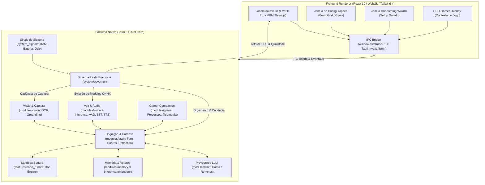

# Mika — System Design & Arquitetura de Sistema (SYSTEM.md)

Este documento define o **System Design Canônico** do projeto **Mika**, detalhando a topologia de processos, subsistemas cognitivos e sensoriais, governança de hardware (RAM/CPU/GPU), padrão ouro de UI/UX e contratos de homologação.

---



---

## 1. Visão Geral do Sistema & Princípios

Mika é um **VTuber AI Companion** projetado para rodar localmente no computador do usuário, oferecendo assistência interativa, companheirismo durante jogos, auxílio em código e entretenimento de cultura nerd.

### Princípios Arquiteturais Fundamentais:
1. **Zero Mocks em Features:** Toda capacidade existe de ponta a ponta. Integração real entre UI, barramento, modelos de inferência e sistema operacional.
2. **Bilateralidade UI ↔ Backend:** Nenhuma função de backend opera às cegas sem representação visível, e nenhum controle de UI é um botão morto.
3. **Privacidade ZDR (Zero Data Retention):** Execução offline padrão com Ollama e modelos neurais locais (ONNX). Telemetria local, logs redigidos sem vazamento de PII e chaves criptografadas no keyring do SO.
4. **Governança Estrita de Hardware:** O companion divide CPU, GPU e memória com jogos AAA e IDEs pesadas. O app se adapta dinamicamente para manter consumo de RAM baixo (<500MB em repouso) e CPU mínima (<1% em idle).
5. **Padrão Ouro de UI/UX:** Consistência estética universal baseada em design tokens semânticos, Bento Grid e componentes modulares de `@mika/sdk-ui/settings`.

---

## 2. Topologia de Processos & Fronteiras de Comunicação

O sistema adota o modelo de processos isolados do **Tauri 2**, eliminando dependências de runtime do Node.js em produção:

### 2.1. Backend Nativo (Rust, `apps/desktop/src-tauri/`)
- **Papel:** Núcleo bloqueante de alta performance, gerenciamento de janelas, hooks de SO, telemetria de hardware, áudio em tempo real e inferência neural.
- **Roteamento & Injeção:** Estado de aplicação mantido pelo gerenciador do Tauri (`app.manage(AppState)`).
- **Barramento de Eventos:** EventBus assíncrono interno tipado em Rust (`apps/desktop/src-tauri/src/events/`), espelhado em `packages/sdk/src/svc/events.ts`.
- **Segurança de Superfície:** Validação de janelas (`assertOwnerSurface`) para impedir que janelas de visualização pública executem comandos privilegiados.

### 2.2. Frontend Renderer (TypeScript / React 19 / Vite / Tailwind 4)
- **Janela do Avatar:** Transparente, posicionável, com suporte a click-through e captura de drag via pointer down.
- **Janela de Configurações:** Interface administrativa modular organizada por abas canônicas.
- **Janela de Onboarding (Setup Wizard):** Experiência de primeiro uso com download de modelos, calibração de microfone e consentimento de privacidade.
- **HUD Overlay:** Widgets transparentes exibindo telemetria do jogo ativo, reações da Mika e transcrição ao vivo.
- **Ponte IPC (`apps/desktop/src/renderer/bridge/`):** Expõe a API global tipada `window.electronAPI` usando `tauri.invoke` e `tauri.listen` com contratos formais em `packages/sdk/src/contracts/desktop-ipc.ts`.

---

## 3. Subsistemas Cognitivos & Sensoriais

### 3.1. Pipeline de Áudio & Fala (`voice` & `inference`)
- **Captura:** Formato padrão fixo em **PCM16 mono 16 kHz**. Reamostragem realizada antes da entrega ao motor.
- **VAD (Voice Activity Detection):** Silero VAD rodando em ONNX. Detecta fala humana com latência sub-30ms e histerese configurada.
- **STT (Speech-to-Text):** Whisper (OpenAI) quantizado em ONNX via `ort`, com suporte à aceleração DirectML/CoreML e fallback transparente para CPU. Alternativa remota via Groq Whisper.
- **TTS (Text-to-Speech):** Modelos locais Supertonic e Kokoro-82M sintetizando fala expressiva. O áudio PCM gerado aciona simultaneamente a saída de som e o controlador de lip-sync do avatar.
- **Detecção de Interrupção:** O detector monitora áudio de entrada durante a síntese de TTS. Se o usuário falar sobre a Mika, o canal de áudio e a geração do LLM são cancelados imediatamente (`turn-abort`).

### 3.2. Cognição & Agente (`brain` & `chat`)
- **Turn-Taking Loop:** Executado sobre o harness `rig-core`. Monta contexto com dados do usuário, humor atual, janela ativa e memórias relevantes.
- **Guardião de Repetição (`RepetitionGuard`):** Impede que a Mika repita frases ou comentários idênticos usando distância de cosseno via embeddings de texto locais.
- **Rastreador de Tópicos & Proatividade:** Monitora a cadência de interações e sugere falas proativas após períodos de silêncio, respeitando cooldowns e o estado do jogo.
- **Ciclo de Reflexão (`reflection`):** A cada 5 turnos de conversa, condensa aprendizados e consolida memórias na base episódica sem bloquear a conversa atual.

### 3.3. Memória & Embeddings (`memory` & `inference/embedder`)
- **Banco Relacional:** SQLite local para histórico de turnos, perfis e configurações.
- **Embeddings Semânticos:** Modelo local `multilingual-e5-small` (384 dimensões, int8 ONNX) rodando in-process com zero chamadas externas. Utilizado para busca em memória e prevenção de repetição.

### 3.4. Visão Computacional (`vision`)
- **Captura:** Multiplataforma (`xcap` / APIs nativas de display).
- **Grounding Visual:** Recorte de elementos sob foco para envio a modelos multimodais (VLM) em cadência orquestrada pelo governador.

---

## 4. Governança de Hardware & Otimizações de Recursos (RAM / CPU / GPU)

Para coexistir harmoniosamente com jogos e aplicações pesadas, a Mika implementa um **Governador de Recursos (`system/governor/`)**:

```
                       ┌───────────────────────┐
                       │ Sinais do Sistema     │
                       │ (Bateria, Jogo, Ócio) │
                       └───────────┬───────────┘
                                   │
                                   ▼
                       ┌───────────────────────┐
                       │  Power Governor       │
                       │  (Policy & Budget)    │
                       └───────────┬───────────┘
                                   │
         ┌─────────────────────────┼─────────────────────────┐
         ▼                         ▼                         ▼
┌──────────────────┐     ┌──────────────────┐     ┌──────────────────┐
│ Teto de FPS      │     │ Evicção ONNX     │     │ Threading Capped │
│ Full: 60 fps     │     │ Whisper/Super-   │     │ ORT intra-op     │
│ Reduced: 30 fps  │     │ tonic/e5 saem da │     │ limitado a núcleos│
│ Eco: 15 fps      │     │ RAM após inati-  │     │ físicos (halved  │
│ Paused: 0 fps    │     │ vidade (2-15 min)│     │ durante jogos)   │
└──────────────────┘     └──────────────────┘     └──────────────────┘
```

### 4.1. Tabela de Orçamentos (Budget Matrix)

| Perfil | Estado | Teto de FPS Avatar | Fator Laços Fundo | Threads ONNX | Descarte Modelo Ocioso |
|---|---|---|---|---|---|
| **Quality** | Qualquer | **Full (60)** | 1x | Max (Cores/2) | Nunca |
| **Auto** | Ativo | **Full (60)** | 1x | Max (Cores/2) | 15 min |
| **Auto** | Jogo Detectado | **Reduced (30)** | 3x | Halved | 10 min |
| **Auto** | Na Bateria | **Reduced (30)** | 2x | Halved | 10 min |
| **Auto** | Ócio do SO (>5m) | **Eco (15)** | 4x | Max | 5 min |
| **Economy** | Ativo | **Reduced (30)** | 2x | Halved | 5 min |
| **Economy** | Ócio / Bateria | **Eco (15)** | 4x-6x | Halved | 2-3 min |

### 4.2. Otimizações de Renderização no Frontend
- **RAF Dormant Throttling:** Quando a janela do avatar ou monitor fica oculta (`document.hidden` ou `quality === 'paused'`), o laço `requestAnimationFrame` é imediatamente interrompido e entra em sono via `setTimeout` de 500ms para checagem de qualidade, eliminando wakeups desnecessários de CPU/GPU. Ao recuperar foco ou visibilidade, o RAF retoma instantaneamente.
- **TTS Level Meter Throttling:** No `PresenceOrb`, após 30 frames de silêncio e volume zerado, o medidor reduz a taxa de amostragem em 70%, prevenindo cálculos desnecessários de interpolação.
- **DPR Clamping:** Canvas 2D/WebGL limitado a `devicePixelRatio <= 2` para evitar sobrecarga de GPU em monitores 4K/HiDPI.

### 4.3. Otimizações de Memória & Compilação
- **Evicção Ociosa de Modelos ONNX:** Modelos pesados de STT/TTS/Embeddings mantêm leases de tempo. Ao expirarem no período de inatividade configurado pelo governador, a sessão ONNX é descartada da memória, liberando 300MB+ de RAM/VRAM.
- **Cargo Package Optimization (`opt-level = 2` em dev e test):** Dependências críticas (`boa_engine`, `image`, `tokenizers`, `realfft`) rodam compiladas em nível de otimização 2, acelerando execução em mais de 10x e evitando starvation de threads sob carga pesada.
- **Monitor de Folga de Memória & Commit:** Alerta proativo quando o commit limit do Windows ou a folga de RAM do sistema atinge níveis críticos, prevenindo falhas de alocação no SO.

---

## 5. Padrão Ouro de UI/UX & Design System

A interface da Mika segue rigorosamente a identidade visual canônica estabelecida pelas telas de Personagem (`features/character`) e Usuário (`features/user`), estendida ao Onboarding Wizard:

### 5.1. Regras Estruturais Canônicas
1. **Hero Snapshot / Identidade no Topo:**
   - Cartão mestre em vidro (`GlassCard span="full"` ou container glass com backdrop-blur).
   - Avatar ou ícone temático em container semântico (`rounded-2xl border border-accent-rim bg-accent-soft text-accent`).
   - Badges e pílulas de status utilizando exclusivamente `StatusPill` com estados semânticos (`ok`, `pending`, `warn`, `danger`).
   - Cabeçalhos tipográficos com tracking expandido (`font-black uppercase tracking-[0.14em]` a `tracking-[0.18em]`).
2. **Composição em Bento Grid & Glass:**
   - Agrupamentos em `GlassSection` com ícones Lucide contextuais e descrições claras.
   - Disposição em `BentoGrid` responsivo (`cols="2"`, `cols="3"` ou `cols="auto"`), contendo `GlassCard`s individuais.
   - Cabeçalhos de seção e rótulos com trackeamento rigoroso (`tracking-[0.12em]`) e divisores visuais semânticos (`SectionDivider`).
3. **Controles Formais Exclusivos do SDK (`@mika/sdk-ui/settings`):**
   - Proibido uso de tags HTML cruas de formulário (`<input>`, `<select>`, `<button>` soltos).
   - Todo campo deve utilizar componentes padronizados: `AuroraField`, `GlassSelect`, `GlassSlider`, `GlassToggle`, `GlassChoiceCards`, `StatTile`, `StatusPill`.
   - Zero literais de cor de paleta (e.g. proibido `bg-slate-900`, `text-blue-500`). Todas as cores derivam estritamente dos tokens semânticos do tema (`--bg`, `--surface`, `--surface-raise`, `--border-subtle`, `--accent`, `--text-main`, `--text-muted`, etc.).

### 5.2. Padronização da Tela de Onboarding (Setup Wizard)
A tela de onboarding (`WizardApp` e seus componentes em `components/wizard/`) implementa integralmente o padrão ouro:
- **Cabeçalho Hero com StatusPill:** Indicador de prontidão do sistema e progresso dinâmico de passos.
- **Passos Modulares em Bento Grid:** Opções de idioma (`LanguageStep`), provedores de IA (`LlmStep`), vozes (`TtsStep`), escuta (`SttStep`) e controles de privacidade (`PrivacyStep`) distribuídos em cartões Bento responsivos.
- **Resumo de Prontidão (`DoneStep`):** Cartões de status padronizados com pílulas de estado, medição de microfone calibrada e atalhos com teclado semântico.
- **Tipografia Trackeada & Botões Aurora:** `StepHeader` com rótulo uppercase `tracking-[0.18em]`, títulos `font-black tracking-tight` e botões de ação primária/secundária com tokens semânticos de acento e foco acessível.

---

## 6. Segurança, Sandboxing & ZDR

1. **Execução Segura de Código (`code_runner`):**
   - O agente pode executar rotinas em JavaScript usando o motor embarcado `Boa` (ECMAScript puro em Rust).
   - Limites de hardware intransponíveis: teto de iteração de laço por frame (`MAX_LOOP_ITERATIONS`), profundidade de recursão (`MAX_RECURSION_DEPTH`) e cancelamento cooperativo com timeout de parede.
   - Isolamento total: nenhum acesso a `require`, `process`, `fetch`, disco ou rede dentro da sandbox.
2. **Aprovação Humana Obrigatória:** Ações destrutivas (modificar arquivos de sistema, executar ferramentas sensíveis) disparam o diálogo modal `ToolApprovalDialog`, exigindo confirmação explícita do usuário.
3. **Guarda de Janela Própria:** Ações de automação de desktop recusam interagir sobre janelas da própria Mika para evitar loops infinitos de clique e foco.

---

## 7. Bateria de Validação & Quality Gates

Nenhuma modificação pode ser mesclada sem aprovação na esteira completa de validação:

| Etapa | Comando | Escopo de Validação |
|---|---|---|
| **Linter** | `pnpm lint` | Validação estrita com Biome (0 erros, 0 warnings não permitidos) |
| **Quality Gates** | `pnpm gates` | 42+ scripts de invariantes (`scripts/checks/`) + `test:rust` |
| **Typecheck** | `pnpm typecheck` | Verificação de tipos TypeScript em todos os workspaces |
| **Testes Unitários** | `pnpm test:unit` | Suíte Vitest de lógica pura, seletores e contratos com catraca de cobertura |
| **Testes Rust** | `pnpm test:rust` | Suíte nativa (`cargo test --lib`) e checagem de paridade cross-language |
| **Build de Produção** | `pnpm build` | Compilação do bundle web e markdown de prompts sem erros |
| **E2E Visual** | `pnpm test` | Playwright em ambiente determinístico gerando screenshots repetíveis |

---

*Documentação mantida sob rigor arquitetural contínuo. Alterações estruturais requerem atualização correspondente deste documento.*
